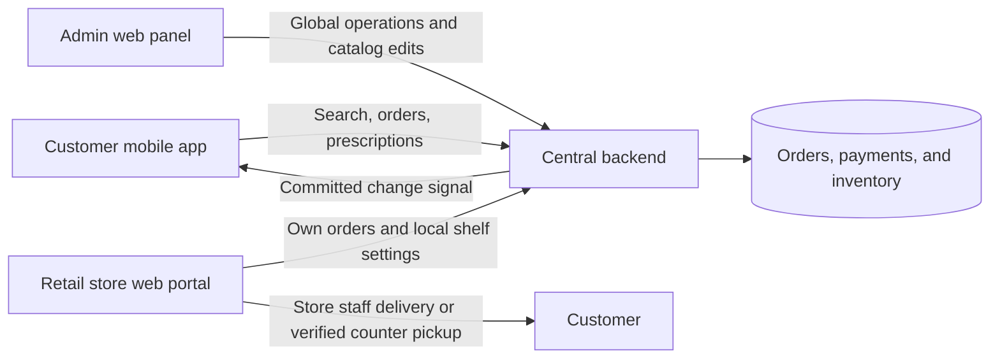

# Store delivery and catalog governance

The existing mobile app handles customer flows. Serve `staff/operations.html` for the admin and retail views through the existing staff session. Store staff handle nearby home delivery or release a verified, packed order at the counter. The master distributor is an inventory source. A retail store remains the fulfillment destination when distributor stock is used.

## Roles and data

| Verified role | Access |
| --- | --- |
| `customer` | Authenticated catalog and owner-scoped orders, prescription actions, and status signals. |
| `admin` | Global orders, routing, payment journal, and central catalog edits on synced SKUs. |
| `retail_store` | Assigned orders, own shelf flags, local rate proposals, and substitute suggestions. |

The migration enables RLS and revokes direct public, anonymous, and authenticated access on the new tables. `inventory_store_override` keys `hidden`, `not_for_sale`, `out_of_stock`, `proposed_rate_paise`, and `suggested_sku_id` by `(store_id, sku_id)`. The flags block only that store's availability until it clears them. `hidden` also removes that store's catalog observation. A visible master or other authorized node can still offer the SKU. Inventory sync leaves the flags in place. Rate proposals and substitute suggestions are stored locally pending policy.

`inventory_catalog_edit` holds the platform's published metadata correction for an existing synced SKU. It takes precedence over partner metadata while a source still lists the SKU. Stock, batches, and source revisions remain partner-owned. `delivery_order_update` holds the latest store update and rejected line IDs by `(order_id, store_id)`. A reassigned order displays updates from the current assignment.

## API contract

Mount `createDeliveryApi` on `/v1/operations`. Bind the same verified staff session used by `/v1/staff/session` and `/v1/staff/logout`. Its cookie must cover the operations API path. The backend derives store identity from the session. POST requests require the portal's same origin. Use the authorized order workflow for any delivery contact details needed by store staff.

| Route under `/v1/operations` | Role and request |
| --- | --- |
| `GET /session` | Staff. Returns `{ role, brandName }`. |
| `GET /orders?after=…` | Admin globally, store scoped to its assignment. Returns `{ items, nextAfter }`. |
| `GET /transactions?after=…` | Admin payment journal, with the same pagination shape. |
| `GET /catalog/:skuId` | Admin loads the current central edit and partner observations. |
| `POST /catalog/:skuId` | Admin replaces published SKU metadata using the normalized inventory catalog fields. |
| `GET /overrides/:skuId` | Store reads its own flags and proposals. |
| `POST /overrides/:skuId` | Store patches `hidden`, `notForSale`, `outOfStock` as booleans, `proposedRatePaise` as a whole-paise string, or `suggestedSkuId`. Send `false` to clear a flag. |
| `POST /orders/:orderId/approve` | Assigned store. `{}` records approval if the order has no blocked or rejected lines. |
| `POST /orders/:orderId/delay` | Assigned store. `{}` records delay. |
| `POST /orders/:orderId/reject-item` | Assigned store. `{ itemId }` records rejection for that order line. |
| `POST /orders/:orderId/dispatch` | Assigned store. `{}` records home dispatch or ready for pickup after verification and packing. |
| `POST /orders/:orderId/complete` | Assigned store. `{}` records delivery or collection. Collection rechecks release eligibility. |

Order actions return `{ status, rejectedItemIds, liveUpdateSent }`. An unknown or foreign assignment returns `404`. The action labels record store reports. Transition rules and partial fulfillment remain open. Rejected lines block release until there is a defined resolution.

## Host wiring and status propagation

1. Apply the delivery migration after inventory and payments. Bind `createDeliveryRepository(transaction)` to the same private Postgres connection as the order repository. In `orders.withOrder(id, callback)`, load and lock the authoritative order and assignment, pass `(order, db)` to the callback, and commit before returning. The order supplies `id`, `kind`, `customerId`, `storeId`, `sourceId`, `fulfillmentMode`, `packed`, and items with `id` and `medicineId`. `orders.listForOperations({ storeId, after, limit })` filters by store when provided and pages by order ID. Use a registered retail inventory node ID for `storeId`.
2. In the authenticated order-create handler, validate and persist `fulfillmentMode` as `store_delivery` or `counter_pickup`, apply server inventory and regulatory checks, and persist the trusted retail assignment. Keep stock source and fulfillment store separate. Bind `authorizeRelease(order, db)` to trusted verification and statutory checks, including the existing prescription workflow's clearance and any restricted-drug rules. The release gate also requires the authoritative packed flag. The host can return public `pickupStore` name and address on the owner's order.
3. Pass the delivery service to `createCustomerPrescriptionApi` to enrich owner-scoped `GET /v1/orders` results with `deliveryStatus` and `rejectedItemIds`. Include the current `storeId` in the authoritative order projection.
4. Bind the server `statusTransport.publish(customerId, { orderId })` and mobile `statusTransport.subscribe({ accessToken, onChange })` to the selected transport. Authenticate and scope subscriptions to the verified customer. Return an unsubscribe callback. A committed store change sends a signal, and the focused Orders screen re-reads the authoritative list. Failed signals leave the committed update readable and return `liveUpdateSent: false`. The app also refreshes on focus and subscription setup. The demo uses local records.

## Open Questions

- What bounds apply to counter rates, and who approves them? Bind `approveLocalRate` before applying proposals.
- Does a substitute need customer, pharmacist, or admin approval? Bind `approveSubstitute` before using suggestions.
- Which transport carries live status and should customers receive push or SMS? Bind `statusTransport` and separately define `notifyCustomer`.
- Is live location tracking required? `trackDeliveryLocation` is unconfigured.
- Which NRX or monitored categories apply and who owns their classifications and clearance? Bind `classifyRestrictedSku` and `authorizeRelease`.
- Can an admin override or lock a store's hidden flag? `administerStoreHiddenFlag` is unconfigured.
- How should store staff authenticate and onboard at scale? Reuse the staff session boundary and define `onboardStoreStaff` and any `granularPermissions`.
- What audit data should be retained for overrides? `recordOverrideAudit` is unconfigured.
- What transitions, partial fulfillment, and customer substitution acceptance are allowed? Define `canTransitionOrder` and `resolveRejectedItems`.
- What happens if a store has no delivery staff, and which store fulfills orders sourced from master stock? Define `resolveUnavailableDelivery` and `resolveMasterStockRetailStore`.
- Does the platform track or pay store delivery staff? `manageDeliveryStaffWork` is unconfigured.
