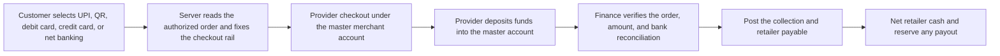
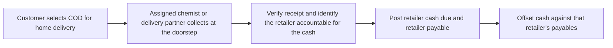
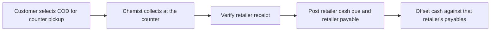

# Payment and settlement

Model A is the default in `src/paymentGateway.mjs`. The server binds the active brand's corporate merchant account and credentials to the provider adapter. The app gets display branding from the existing brand config. Credentials and bank routing stay server-side. Model B has sub-merchant and split-settlement hooks that fail closed.

## Digital checkout

## COD home delivery

## COD counter pickup

## Ledger

`payment_journal` identifies the collection, settlement, or confirmed payout and its retailer. `payment_transfer` stores an equal debit and credit as one row, with an exact positive whole-paise amount. A collection may be posted once per order. Receipt references are unique within a rail. The repository commits a complete journal atomically and locks postings for the same retailer during settlement.

| Event | Debit | Credit |
| --- | --- | --- |
| Reconciled digital collection | Master collections clearing, for gross order value | Platform commission, partner payable including the tagged retail margin, and unallocated order proceeds clearing |
| Bank deposit matched to the digital collection | Master bank for the received amount and deposit difference clearing for any difference | Master collections clearing |
| Verified COD collection | Cash due from the accountable retailer, for gross order value | Same allocation as digital |
| Settlement preparation | Partner payable | Cash due up to the lower balance, then payout reserve for the remaining payable |
| Bank-confirmed payout | Payout reserve | Master bank |

The reservation is a cutoff for a specific settlement ID. Later collections affect later settlements. For example, if a retailer has ₹800 payable and ₹300 cash due, the system offsets ₹300 and reserves ₹500. If cash due exceeds payables, it reserves no payout and carries the excess forward. Amounts held in either clearing account are outside retailer payables. Clearing balances preserve unallocated proceeds and deposit differences until accounting policy classifies them.

## Host contract

- Mount `createPaymentApi` with verified bearer authentication. Its POST routes are `/v1/payments/checkout`, `/v1/internal/payments/digital`, `/v1/internal/payments/cod`, `/v1/internal/settlements/prepare`, and `/v1/internal/settlements/payout`. Use the inputs on the corresponding service methods. Order access is checked by action and scope. Settlement actions require finance permission scoped to the retailer.
- `orders.readAuthorized(actor, orderId, action)` returns an authoritative order and its gross as a decimal-string paise amount. `orders.selectRail` atomically fixes the rail, method, and price for the checkout attempt and supports safe retries of the same selection. Do not change partner or commercial terms after posting. Customer requests supply neither totals nor financial account references.
- The gateway provider implements `createMasterCheckout` and `readReconciledMasterDeposit`. It keeps one checkout per idempotency key and returns only customer-safe checkout data. It verifies that the individual payment and actual bank deposit reconcile to the configured merchant, even if the provider deposits in batches. It must confirm the final collected and deposited amounts independently of the client. No card data passes through this API.
- `allowCod` applies approved COD policy. `allowPathologyPayment` explicitly enables a pathology rail only after its policy is agreed. `resolveCommercialTerms` supplies commission, retail margin, and any other payable in whole paise. `verifyCodCollection` checks collector authorization and supplies the actual accountable retailer. `verifyMasterPayout` reads a confirmed transfer from the master bank account.
- Use the migration and `createPostgresPaymentLedger` with a private backend transaction adapter. Prepare a settlement before making an external payout. Confirm the reserved amount and use the settlement ID to deduplicate the payout at the bank or payout provider. Record the confirmed payout against the reservation. A pending or ambiguous payout keeps its reservation.

## Open Questions

- Which aggregator and corporate merchant credentials should the host use? The vendor checkout and bank-reconciliation adapters are stubbed.
- Will leadership adopt Model A, Model B, or a hybrid? Model B and split settlements are disabled.
- How often should payouts run, and what report is required? Payout scheduling, transfer execution, and reporting are outside the current ledger.
- How are commission, retail margin, and other payables calculated per order or category? Who owns residual proceeds and how should gateway deductions be classified?
- Who collects home-delivery COD, and how is a separate courier reconciled to the accountable retailer? What COD limits, restrictions, or fees apply?
- How should GST, TDS, and TCS be calculated, recorded, and filed?
- What refund and cancellation rules apply to digital and COD orders?
- Do pathology bookings follow the same rails, settlement, and commercial rules as medicine orders?
- Which order payment states are needed? Which webhook events should be handled, and how should provider callback authenticity and deduplication work?
- What invoice format and issuance rules apply?
